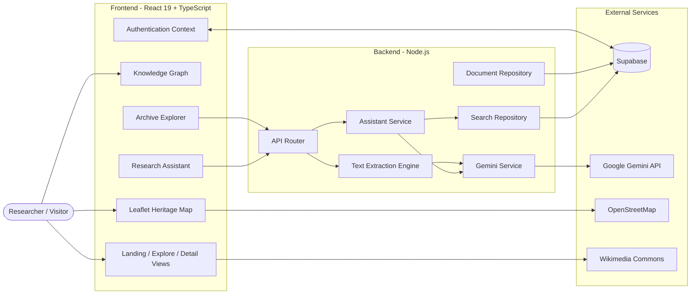
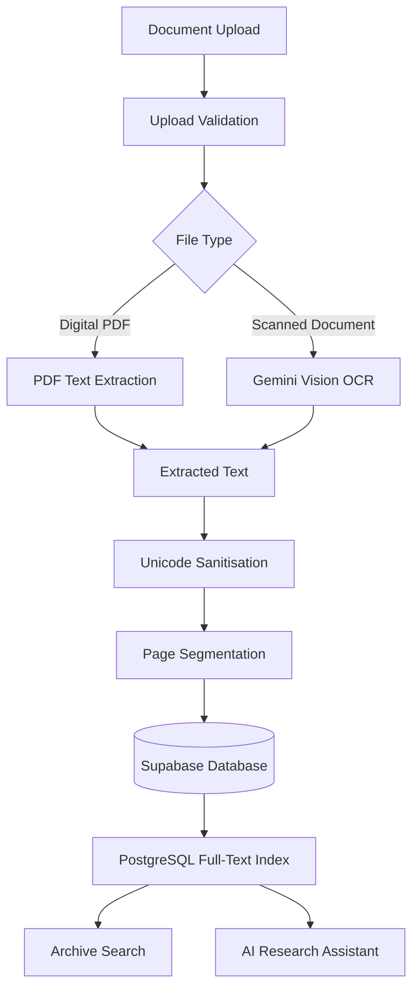
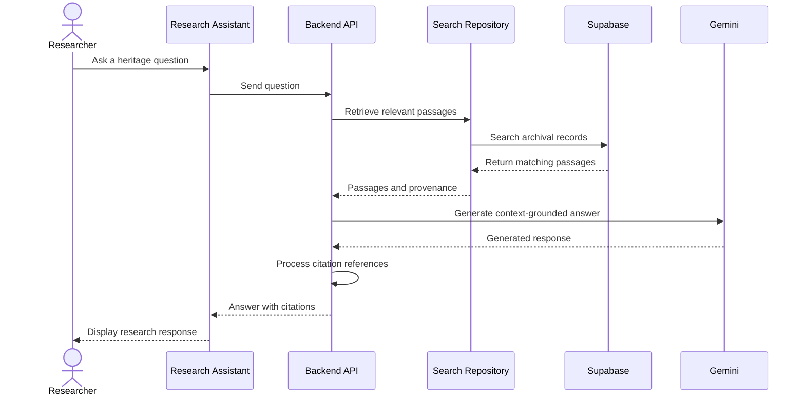
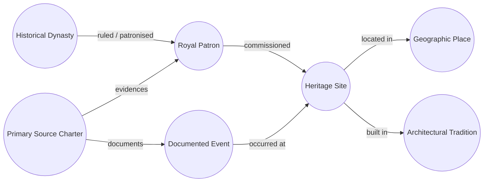

 <div align="center">

# 🏛️ Virasat

### Every place has a story. Every story deserves to live.

**AI-powered digital revitalisation of India's cultural and architectural heritage archives.**

🌐 **[Explore the Live Demo](https://hackiitg.onrender.com/)**


</div>

---

## 📑 Table of Contents

1. [Problem Statement](#-problem-statement)
2. [Project Overview](#-project-overview)
3. [Key Features](#-key-features)
4. [System Architecture](#️-system-architecture)
5. [Technology Stack](#-technology-stack)
6. [Repository Structure](#-repository-structure)
7. [API Reference](#-api-reference)
8. [Getting Started](#-getting-started-local-setup)
9. [Environment Variables](#-environment-variables)
10. [Database Setup](#️-database-setup-supabase)
11. [Authentication](#-authentication--google-sign-in)
12. [Running Tests](#-running-tests)
13. [Production Build & Deployment](#-production-build--deployment)
14. [Security Notes](#️-security-notes)
15. [Troubleshooting](#-troubleshooting)
16. [Future Scope](#-future-scope)
17. [License & Attribution](#-license--attribution)

---

## 🎯 Problem Statement

**Digital Revitalisation of Unstructured Cultural & Architectural Heritage Archives**

India's cultural heritage is documented across historical survey monographs, inscriptions, manuscripts, archival records, and archaeological field notes.

Much of this information remains scattered, difficult to search, and disconnected from related historical records.

Virasat aims to transform fragmented heritage information into a **searchable, interconnected, and evidence-based digital knowledge platform**, making India's cultural and architectural history more accessible.

---

## 🌟 Project Overview

**Virasat** is an AI-powered heritage research and exploration platform designed for researchers, historians, students, and cultural institutions.

It brings together heritage discovery, archival digitisation, document search, interactive visualisation, and AI-assisted research in one platform.

With Virasat, users can:

- **Explore** 42 monuments across 14 Indian states.
- **Search** archival documents and discover relevant passages.
- **Digitise** digital PDFs and scanned manuscripts using text extraction and AI-powered OCR.
- **Discover** historical connections between monuments, patrons, dynasties, places, and events.
- **Visualise** heritage locations through an interactive geographical map.
- **Ask** research questions using an AI assistant grounded in available archival evidence.

---

## ✨ Key Features

| Feature                         | Description                                                                                                                                         |
| ------------------------------- | --------------------------------------------------------------------------------------------------------------------------------------------------- |
| **Interactive Knowledge Graph** | Explore relationships between heritage sites, royal patrons, places, dynasties, architectural traditions, historical events, and archival charters. |
| **Heritage Dataset**            | Explore 42 monuments across 14 states, with architectural classifications, historical information, and image attribution.                           |
| **Archival Vault**              | Search archival documents using full-text search, relevant snippets, highlighting, and filters.                                                     |
| **Document Ingestion**          | Extract text from digital PDFs and use Gemini-powered OCR for scanned documents and manuscripts.                                                    |
| **AI Research Assistant**       | Ask questions and receive answers based on retrieved archival passages, with citation references.                                                   |
| **Interactive Heritage Map**    | Discover heritage locations using Leaflet and OpenStreetMap.                                                                                        |
| **Researcher Accounts**         | Sign in, manage sessions, and access personal collections when authentication is configured.                                                        |
| **Heritage Image Management**   | Centralised image catalogue with attribution and fallback images.                                                                                   |
| **Interactive Experiences**     | Explore additional heritage-related views and activities through the application.                                                                   |

---

## 🏗️ System Architecture

### 1. High-Level Architecture



### 2. Document Ingestion & OCR Pipeline



### 3. AI Research Assistant – RAG Workflow



### 4. Knowledge Graph Model

The knowledge graph connects seven categories of heritage information:



Relationships are supported by evidence records in the knowledge graph database model.

### 5. Architecture Layers

| Layer             | Responsibility                                                                       |
| ----------------- | ------------------------------------------------------------------------------------ |
| **Frontend**      | React UI, navigation, interactive maps, knowledge graph, and user interactions.      |
| **Backend API**   | API routing, authentication checks, document processing, and AI service integration. |
| **Supabase**      | PostgreSQL database, authentication, storage, and persistent records.                |
| **Gemini**        | AI-powered OCR and research response generation.                                     |
| **External Data** | OpenStreetMap tiles and Wikimedia Commons imagery.                                   |

---

## 🧰 Technology Stack

| Category            | Technologies                     |
| ------------------- | -------------------------------- |
| Frontend            | React 19, TypeScript             |
| Build Tool          | Vite                             |
| Styling             | Tailwind CSS v4                  |
| Backend             | Node.js, API middleware, Express |
| Database            | Supabase PostgreSQL              |
| Authentication      | Supabase Auth                    |
| AI & OCR            | Google Gemini                    |
| Maps                | Leaflet, OpenStreetMap           |
| Document Processing | pdf-parse                        |
| Testing             | Node.js Test Runner, tsx         |
| Deployment          | Render                           |

---

## 📁 Repository Structure

The project follows a modular structure that separates frontend components, application data, backend services, database migrations, and utility logic.

```text
HackIITG/
│
├── index.html
├── package.json
├── package-lock.json
├── tsconfig.json
├── vite.config.ts
├── server.ts
├── metadata.json
├── .env.example
├── .gitignore
│
├── data/
│   ├── documents_vault.json
│   └── document_pages_vault.json
│
├── supabase/
│   ├── schema.sql
│   ├── knowledge_graph.sql
│   ├── schema_step2_documents.sql
│   ├── schema_step4_document_pages.sql
│   └── schema_step5_search.sql
│
└── src/
    │
    ├── main.tsx
    ├── App.tsx
    ├── index.css
    │
    ├── components/
    │   ├── LandingPage.tsx
    │   ├── Header.tsx
    │   ├── Footer.tsx
    │   ├── Logo.tsx
    │   ├── LanguageSwitcher.tsx
    │   ├── ExploreView.tsx
    │   ├── HeritageDetailView.tsx
    │   ├── SiteDetailModal.tsx
    │   ├── HeritageImage.tsx
    │   ├── HeritageMapView.tsx
    │   ├── LeafletMap.tsx
    │   ├── ModelViewer3D.tsx
    │   ├── ArchiveExplorerView.tsx
    │   ├── ArchiveViewer.tsx
    │   ├── DocumentUploadView.tsx
    │   ├── DocumentUploadModal.tsx
    │   ├── DocumentDetailModal.tsx
    │   ├── ResearchAssistantView.tsx
    │   ├── CollectionView.tsx
    │   ├── SaveButton.tsx
    │   ├── GamesView.tsx
    │   ├── AdminImportView.tsx
    │   ├── ProjectDossier.tsx
    │   ├── KnowledgeGraphRoute.tsx
    │   │
    │   ├── auth/
    │   ├── games/
    │   ├── motion/
    │   └── knowledgeGraph/
    │
    ├── contexts/
    │   └── AuthContext.tsx
    │
    ├── data/
    │   ├── authenticHeritageDataset.ts
    │   ├── heritageData.ts
    │   ├── seedHeritageSites.ts
    │   ├── seedKnowledgeGraph.ts
    │   ├── archiveData.ts
    │   └── heritageImages.ts
    │
    ├── lib/
    │   ├── supabase.ts
    │   ├── supabaseAdmin.ts
    │   ├── savedSites.ts
    │   └── knowledgeGraphExtraction.ts
    │
    ├── server/
    │   ├── api.ts
    │   ├── assistantService.ts
    │   ├── geminiService.ts
    │   ├── geminiModels.ts
    │   ├── textExtractionEngine.ts
    │   ├── documentRepository.ts
    │   ├── searchRepository.ts
    │   └── rateLimit.ts
    │
    ├── types/
    │   ├── database.types.ts
    │   ├── heritage.ts
    │   ├── knowledgeGraph.ts
    │   └── index.ts
    │
    └── utils/
        ├── archiveSearch.ts
        ├── graphLogic.ts
        ├── heritageDataImporter.ts
        ├── heritageLogic.ts
        ├── heritageMap.ts
        ├── ocrPipeline.ts
        ├── researchAssistant.ts
        └── uploadValidation.ts
```

### Where to make changes

| Task                                   | Location                         |
| -------------------------------------- | -------------------------------- |
| Modify application pages and UI        | `src/components/`                |
| Update heritage monument data          | `src/data/`                      |
| Change heritage images and attribution | `src/data/heritageImages.ts`     |
| Modify knowledge graph data            | `src/data/seedKnowledgeGraph.ts` |
| Update API endpoints                   | `src/server/api.ts`              |
| Change AI and OCR behaviour            | `src/server/`                    |
| Update authentication logic            | `src/contexts/AuthContext.tsx`   |
| Modify database schemas                | `supabase/`                      |
| Update application entry point         | `src/App.tsx`                    |
| Modify production server               | `server.ts`                      |
| Update reusable logic                  | `src/utils/`                     |

---

## 🔌 API Reference

The API routes are handled by `src/server/api.ts`.

Protected endpoints require a valid Supabase access token in the request header:

```http
Authorization: Bearer <SUPABASE_ACCESS_TOKEN>
```

| Method | Endpoint                              | Authentication | Purpose                                |
| ------ | ------------------------------------- | -------------- | -------------------------------------- |
| GET    | `/api/database/status`                | No             | Check database connectivity.           |
| GET    | `/api/documents`                      | No             | Retrieve archival documents.           |
| GET    | `/api/documents/pages?documentId=...` | No             | Retrieve document page transcriptions. |
| GET    | `/api/archive/search`                 | No             | Search archival passages.              |
| POST   | `/api/documents/upload`               | Yes            | Upload archival documents.             |
| POST   | `/api/documents/process`              | Yes            | Extract and process document text.     |
| POST   | `/api/documents/signed-url`           | Yes            | Generate a temporary private file URL. |
| POST   | `/api/archive/assistant`              | Yes            | Ask the AI research assistant.         |
| POST   | `/api/archive/ocr`                    | Yes            | Process image-based OCR requests.      |

**Search parameters:** `q`, `type`, `period`, `location`, `language`, `verification`, `limit`, and `offset`.

---

## 🚀 Getting Started (Local Setup)

### Prerequisites

| Requirement | Version             |
| ----------- | ------------------- |
| Node.js     | 20.19+ or 22.12+    |
| npm         | 9+                  |
| Git         | Latest stable       |
| Code Editor | VS Code recommended |

Check your installed versions:

```bash
node -v
npm -v
git --version
```

### 1. Get the project source

Download the project source and open the project directory in your terminal.

```bash
cd HackIITG
```

### 2. Install dependencies

```bash
npm install
```

### 3. Configure environment variables

```bash
cp .env.example .env.local
```

Add the required credentials to `.env.local`. Refer to the [Environment Variables](#-environment-variables) section.

### 4. Start the development server

```bash
npm run dev
```

Open the application at:

**http://localhost:3000**

> **Note:** Some features require Supabase and Gemini credentials. Public browsing and locally available data may work without configuring these services.

---

## 🔐 Environment Variables

Create a `.env.local` file in the project root.

```env
GEMINI_API_KEY=your_gemini_api_key
APP_URL=http://localhost:3000

VITE_SUPABASE_URL=your_supabase_project_url
VITE_SUPABASE_ANON_KEY=your_supabase_anon_key
SUPABASE_SERVICE_ROLE_KEY=your_supabase_service_role_key

GEMINI_MODEL=
GEMINI_FALLBACK_MODEL=

PORT=3000
ALLOW_ANONYMOUS_API=false
```

| Variable                    | Purpose                                       |
| --------------------------- | --------------------------------------------- |
| `GEMINI_API_KEY`            | Gemini API access for OCR and AI research.    |
| `APP_URL`                   | Application base URL.                         |
| `VITE_SUPABASE_URL`         | Supabase project URL.                         |
| `VITE_SUPABASE_ANON_KEY`    | Public Supabase client key.                   |
| `SUPABASE_SERVICE_ROLE_KEY` | Server-side database and storage operations.  |
| `GEMINI_MODEL`              | Optional primary Gemini model override.       |
| `GEMINI_FALLBACK_MODEL`     | Optional fallback model override.             |
| `PORT`                      | Server port.                                  |
| `ALLOW_ANONYMOUS_API`       | Development-only anonymous API configuration. |

### Feature availability

| Configuration                    | Features                                            |
| -------------------------------- | --------------------------------------------------- |
| No credentials                   | Public heritage browsing and available local data.  |
| Supabase configured              | Authentication and persistent records.              |
| Supabase service role configured | Server-side uploads and private storage operations. |
| Gemini configured                | AI OCR and research assistant functionality.        |

---

## 🗄️ Database Setup (Supabase)

Database schemas and migrations are stored in the `supabase/` directory.

Run the SQL files in the following order:

| Order | File                              | Purpose                                                |
| ----- | --------------------------------- | ------------------------------------------------------ |
| 1     | `schema.sql`                      | Base database tables and policies.                     |
| 2     | `knowledge_graph.sql`             | Knowledge graph entities, relationships, and evidence. |
| 3     | `schema_step2_documents.sql`      | Document metadata and storage policies.                |
| 4     | `schema_step4_document_pages.sql` | Page-level document records.                           |
| 5     | `schema_step5_search.sql`         | Full-text search and indexing.                         |

**Recommended method: Supabase SQL Editor**

1. Open your Supabase project.
2. Navigate to the SQL Editor.
3. Open each migration file.
4. Execute the SQL files in the specified order.
5. Verify that the required tables and policies have been created.

---

## 👤 Authentication & Google Sign-In

Virasat uses Supabase Authentication for researcher accounts.

Supported authentication functionality includes:

- User sign-up and sign-in.
- Password reset.
- Persistent authentication sessions.
- Google OAuth, when configured.
- Personal collections and saved records.

### Supabase configuration

1. Create a Supabase project.
2. Copy the project URL and public anon key.
3. Add them to `.env.local`.
4. Apply the database migrations.
5. Configure the authentication providers you want to use.

### Google OAuth configuration

1. Open the Google Cloud Console.
2. Navigate to **APIs & Services → Credentials**.
3. Create an OAuth Client ID for a Web Application.
4. Add the Supabase callback URL:

```text
https://<your-project>.supabase.co/auth/v1/callback
```

5. Open **Supabase → Authentication → Providers → Google**.
6. Enable Google and configure the Client ID and Client Secret.

Configure your application URLs under **Authentication → URL Configuration**:

**Site URL**

```text
https://hackiitg.onrender.com
```

**Redirect URLs**

```text
https://hackiitg.onrender.com/**
http://localhost:3000/**
```

Authentication-dependent features require valid Supabase configuration.

---

## 🧪 Running Tests

The project includes unit tests for application logic.

Run the available scripts:

```bash
npm test
```

Run individual utility test files:

```bash
npx tsx --test src/utils/*.test.ts
```

The test suites cover areas such as:

| Test Suite                     | Coverage                                      |
| ------------------------------ | --------------------------------------------- |
| `graphLogic.test.ts`           | Graph entities, relationships, and traversal. |
| `heritageDataImporter.test.ts` | Dataset validation and image attribution.     |
| `heritageLogic.test.ts`        | Distance calculations and heritage logic.     |
| `heritageMap.test.ts`          | Coordinates and map-related calculations.     |
| `ocrPipeline.test.ts`          | Text extraction and OCR processing.           |
| `researchAssistant.test.ts`    | Research assistant and citation logic.        |
| `uploadValidation.test.ts`     | Document upload validation.                   |

---

## 🌍 Production Build & Deployment

Build the application:

```bash
npm run build
```

Start the production server:

```bash
npm start
```

### Render deployment

The application is deployed on Render.

**Live application:** [https://hackiitg.onrender.com/](https://hackiitg.onrender.com/)

For a Node.js Web Service, use the following configuration if it matches your deployment setup:

| Setting       | Value                          |
| ------------- | ------------------------------ |
| Service Type  | Web Service                    |
| Runtime       | Node                           |
| Build Command | `npm install && npm run build` |
| Start Command | `npm start`                    |

Add the required environment variables in the Render dashboard.

> **Important:** The backend API requires a running server. A static-only deployment will not support server-side API functionality.

---

## 🛡️ Security Notes

- Never commit `.env.local` or real API credentials.
- Never expose `SUPABASE_SERVICE_ROLE_KEY` or `GEMINI_API_KEY` in frontend code.
- Only public Supabase credentials should be used by browser-side code.
- Protected API endpoints should validate authentication server-side.
- Validate uploaded files before processing.
- Apply appropriate rate limits to API endpoints.
- Use Supabase Row Level Security to protect private researcher data.
- Keep third-party image attribution and licensing information intact.

---

## 🩺 Troubleshooting

| Problem                              | Possible Solution                                                                                        |
| ------------------------------------ | -------------------------------------------------------------------------------------------------------- |
| `npm install` fails                  | Check your Node.js and npm versions.                                                                     |
| Port 3000 is already in use          | Stop the process using the port or configure another port.                                               |
| Login or sign-up does not work       | Verify Supabase URL and anon key configuration.                                                          |
| Google sign-in redirects incorrectly | Check the Supabase Site URL and Redirect URLs.                                                           |
| OCR or AI assistant does not respond | Verify the Gemini API key and model configuration.                                                       |
| Document uploads fail                | Check authentication, storage configuration, and database migrations.                                    |
| Search returns no results            | Verify that search migrations have been applied and documents are indexed.                               |
| API requests fail after deployment   | Verify that the application is running as a Node.js Web Service with the required environment variables. |

---

## 🔮 Future Scope

- Expand the heritage dataset to cover more Indian states.
- Introduce more detailed 3D reconstruction of historical monuments.
- Improve multilingual manuscript transcription and translation.
- Expand archival document digitisation workflows.
- Improve automated discovery of historical relationships.
- Integrate institutional and public heritage archives.
- Develop richer educational and interactive heritage experiences.

---

## 📜 License & Attribution

Cultural data and project materials are intended to follow the project's applicable licensing and attribution requirements.

Potential reference sources include:

- Archaeological Survey of India (ASI).
- UNESCO World Heritage documentation.
- _Epigraphia Indica_.
- Public-domain historical monographs and archival collections.
- Wikimedia Commons.

Photographs and third-party materials retain their respective attribution and licence requirements. Refer to `src/data/heritageImages.ts` for image attribution information.

---

<div align="center">

### 🏛️ Virasat

**Preserving the Past, Connecting the Present, Inspiring the Future.**

Made with the vision of making India's cultural heritage accessible to everyone.

🌐 **[Explore Virasat – Live Demo](https://hackiitg.onrender.com/)**

</div>
