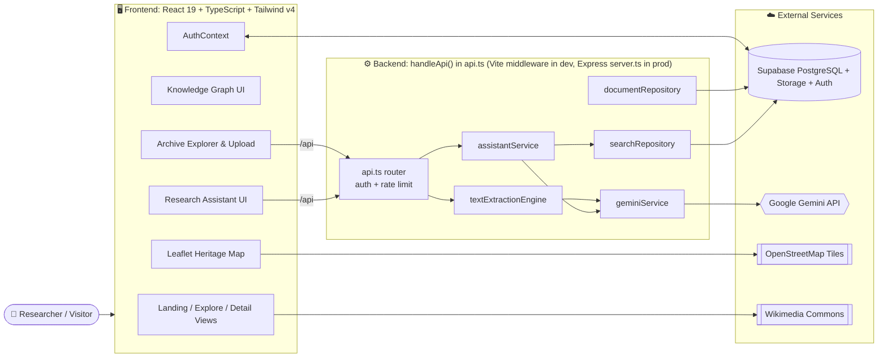
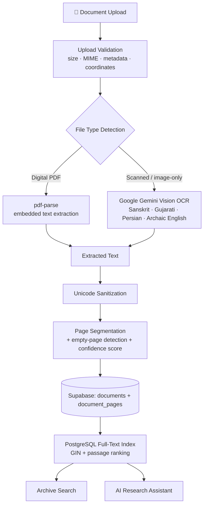
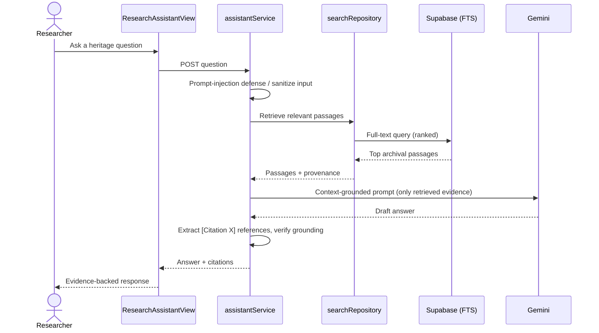
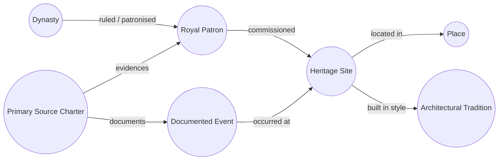

<div align="center">

# 🏛️ Virasat

### Every place has a story. Every story deserves to live.

**AI-powered digital revitalisation of India's cultural & architectural heritage archives**

[](https://hackiitg.onrender.com/)
[](https://github.com/bpvankar496-ux/HackIITG)


**🌐 Live:** https://hackiitg.onrender.com/ &nbsp;|&nbsp; **💻 Code:** https://github.com/bpvankar496-ux/HackIITG

</div>

---

## 📑 Table of Contents

1. [Problem Statement](#-problem-statement)
2. [Project Overview](#-project-overview)
3. [Key Features](#-key-features)
4. [System Architecture](#-system-architecture)
5. [Technology Stack](#-technology-stack)
6. [Repository Structure](#-repository-structure)
7. [Getting Started (Local Setup)](#-getting-started-local-setup)
8. [Environment Variables](#-environment-variables)
9. [Database Setup (Supabase)](#-database-setup-supabase)
10. [Authentication & Google Sign-In](#-authentication--google-sign-in)
11. [Running Tests](#-running-tests)
12. [Production Build & Deployment](#-production-build--deployment)
13. [Security Notes](#-security-notes)
14. [Troubleshooting](#-troubleshooting)
15. [Future Scope](#-future-scope)
16. [License & Attribution](#-license--attribution)

---

## 🎯 Problem Statement

**Digital Revitalisation of Unstructured Cultural & Architectural Heritage Archives**

India's heritage knowledge is scattered across colonial-era survey monographs, Sanskrit inscriptions, Persian charters, scanned manuscripts and archaeological field notes. Most of it is unsearchable, unlinked and hard to verify. Virasat turns this fragmented material into a **searchable, verified and interconnected** digital knowledge platform.

---

## 🌟 Project Overview

**Virasat** is a heritage research platform that lets researchers, historians, students and institutions:

- **Explore** 42 monuments across 14 Indian states
- **Search** deep inside archival documents, down to the exact sentence
- **Digitise** both born-digital PDFs and scanned manuscripts with AI OCR
- **Discover** hidden connections between sites, patrons, dynasties and events through a knowledge graph
- **Ask** questions to an AI assistant that answers _only_ from archival evidence, with citations

---

## ✨ Key Features

| #   | Feature                                  | What it does                                                                                                                                                                                                                        |
| --- | ---------------------------------------- | ----------------------------------------------------------------------------------------------------------------------------------------------------------------------------------------------------------------------------------- |
| 1   | **Interactive Knowledge Graph**          | Force-directed network modelling multi-hop relationships across 7 dimensions: Heritage Sites, Royal Patrons, Geographic Places, Historical Dynasties, Architectural Traditions, Documented Events, Primary Source Charters          |
| 2   | **Authentic Heritage Corpus**            | 42 monuments, 14 states, UNESCO and ASI references, style taxonomy (Māru-Gurjara, Nagara, Dravidian, Indo-Islamic, Kalinga, Nilachal), Wikimedia Commons photography with attribution                                               |
| 3   | **Archival Vault & Deep Passage Search** | Full-text search, exact matching snippets, highlighting, relevance ranking, multi-facet filters, XSS-safe tokenization                                                                                                              |
| 4   | **Dual-Path Document Ingestion**         | Path A: digital PDFs via `pdf-parse`. Path B: scanned manuscripts via Gemini vision OCR. Supports Sanskrit (Devanagari), Gujarati, Persian and archaic English, with confidence scoring, page segmentation and empty-page detection |
| 5   | **Grounded AI Research Assistant**       | RAG over indexed archives, `[Citation X]` references, prompt-injection resistance, anti-hallucination safeguards                                                                                                                    |
| 6   | **Geospatial Heritage Map**              | Leaflet + OpenStreetMap, verified coordinates, geographic clustering, geolocated survey records                                                                                                                                     |
| 7   | **Researcher Accounts**                  | Sign in / sign up, password reset, Google OAuth (when configured), persistent sessions, personal collections and saved records                                                                                                      |
| 8   | **Reliable Heritage Imagery**            | Central slug-based image catalog, photographer and licence attribution, category-aware fallbacks if remote images fail                                                                                                              |
| 9   | **Fast Navigation**                      | Lazy-loaded sections, separately loaded 3D viewer, hash routes (`#/heritage/:slug`) with reliable back navigation                                                                                                                   |

---

## 🏗️ System Architecture

### 1. High-Level Architecture



### 2. Document Ingestion & OCR Pipeline



### 3. Grounded Research Assistant (RAG Flow)



### 4. Knowledge Graph Model



> Relationships are stored with supporting evidence in the `knowledge_graph.sql` tables (entities, relationships, evidence). The relationship labels above are illustrative of the model.

### 5. Request Flow Summary

| Layer                   | Responsibility                                                                                                                                             |
| ----------------------- | ---------------------------------------------------------------------------------------------------------------------------------------------------------- |
| **Browser (React)**     | Rendering, routing via hash state, lazy loading, Leaflet map, force-directed graph canvas, session handling through Supabase client (public anon key only) |
| **API layer (Node.js)** | All secret-bearing work: Gemini calls, OCR, document processing, signed URLs, private storage via the service-role key                                     |
| **Supabase**            | PostgreSQL (heritage records, documents, pages, collections), Row Level Security, Auth, Storage                                                            |
| **Gemini**              | Vision OCR for scanned manuscripts, answer generation for the research assistant                                                                           |

**Graceful degradation:** with no external credentials, public browsing, seed knowledge graph, and local fallback search still work. OCR, authenticated uploads, private storage and AI research need their respective keys.

---

## 🧰 Technology Stack

| Category            | Technologies                                  |
| ------------------- | --------------------------------------------- |
| Frontend            | React 19, TypeScript                          |
| Build Tool          | Vite                                          |
| Styling             | Tailwind CSS v4                               |
| Backend             | Node.js, Vite API middleware                  |
| Database            | Supabase PostgreSQL                           |
| Authentication      | Supabase Auth (email/password + Google OAuth) |
| AI & OCR            | Google Gemini                                 |
| Maps                | Leaflet, OpenStreetMap                        |
| Document Processing | pdf-parse                                     |
| Testing             | Node.js Test Runner, tsx                      |
| Deployment          | Render                                        |

---

## 📁 Repository Structure

```text
HackIITG/
├── server.ts                  # Production Express server: serves dist/ + /api routes
├── vite.config.ts             # Vite config + dev-time /api middleware
├── index.html                 # App HTML entry
├── package.json               # Scripts and dependencies (package name: virasat-quest)
├── tsconfig.json
├── metadata.json
├── .env.example               # Template for environment variables
├── .gitignore
│
├── data/                      # Runtime fallback vault (JSON)
│   ├── documents_vault.json
│   └── document_pages_vault.json
│
├── supabase/                  # SQL migrations (run in this order)
│   ├── schema.sql
│   ├── knowledge_graph.sql
│   ├── schema_step2_documents.sql
│   ├── schema_step4_document_pages.sql
│   └── schema_step5_search.sql
│
└── src/
    ├── main.tsx               # React entry point
    ├── App.tsx                # Root app, hash routing, lazy-loaded sections
    ├── index.css              # Tailwind entry
    │
    ├── components/            # ── Frontend views ──
    │   ├── LandingPage.tsx · Header.tsx · Footer.tsx · Logo.tsx · LanguageSwitcher.tsx
    │   ├── ExploreView.tsx · HeritageDetailView.tsx · SiteDetailModal.tsx
    │   ├── HeritageImage.tsx          # Shared image component with fallbacks
    │   ├── HeritageMapView.tsx · LeafletMap.tsx
    │   ├── ModelViewer3D.tsx          # Optional 3D viewer (loaded separately)
    │   ├── ArchiveExplorerView.tsx · ArchiveViewer.tsx
    │   ├── DocumentUploadView.tsx · DocumentUploadModal.tsx · DocumentDetailModal.tsx
    │   ├── ResearchAssistantView.tsx
    │   ├── CollectionView.tsx · SaveButton.tsx
    │   ├── GamesView.tsx
    │   ├── AdminImportView.tsx · ProjectDossier.tsx
    │   ├── KnowledgeGraphRoute.tsx
    │   │
    │   ├── auth/                      # LoginView · SignUpView · GoogleButton
    │   ├── games/                     # HeritageQuiz · SimonHeritage · useHeritagePool
    │   ├── motion/                    # Reveal · TiltCard (animations)
    │   └── knowledgeGraph/            # KnowledgeGraphView · InteractiveGraphCanvas ·
    │                                  # GraphLegend · GraphFilterBar · GraphControls ·
    │                                  # EntityDetailsPanel · RelationshipDetailsPanel ·
    │                                  # GraphListView · ArchivalExtractionModal
    │
    ├── contexts/
    │   └── AuthContext.tsx            # Session and auth state
    │
    ├── data/                  # ── Curated + seed datasets ──
    │   ├── authenticHeritageDataset.ts
    │   ├── heritageData.ts · seedHeritageSites.ts
    │   ├── seedKnowledgeGraph.ts · archiveData.ts
    │   └── heritageImages.ts          # Image catalog + attribution
    │
    ├── lib/                   # ── Client/shared helpers ──
    │   ├── supabase.ts                # Browser Supabase client + auth headers
    │   ├── supabaseAdmin.ts           # Service-role client (server only)
    │   ├── savedSites.ts              # Saved-sites logic
    │   └── knowledgeGraphExtraction.ts
    │
    ├── server/                # ── Backend logic (secrets live here) ──
    │   ├── api.ts                     # Framework-neutral router: handleApi()
    │   ├── assistantService.ts        # RAG orchestration
    │   ├── geminiService.ts           # Gemini client
    │   ├── geminiModels.ts            # Model names + fallback config
    │   ├── textExtractionEngine.ts    # PDF vs OCR routing
    │   ├── documentRepository.ts      # Document persistence
    │   ├── searchRepository.ts        # Full-text search queries
    │   └── rateLimit.ts               # In-memory sliding-window limiter
    │
    ├── types/                 # database.types · heritage · knowledgeGraph · index
    │
    └── utils/                 # ── Pure logic, each with a co-located *.test.ts ──
        ├── archiveSearch · graphLogic · heritageDataImporter
        ├── heritageLogic · heritageMap · ocrPipeline
        └── researchAssistant · uploadValidation
```

### Where things live

| I want to change...           | Look in                                                                         |
| ----------------------------- | ------------------------------------------------------------------------------- |
| A page or UI view             | `src/components/`                                                               |
| Monument data or photos       | `src/data/` (`heritageImages.ts` for photos)                                    |
| Knowledge graph data or logic | `src/data/seedKnowledgeGraph.ts`, `src/utils/graphLogic.ts`                     |
| An API endpoint               | `src/server/api.ts`                                                             |
| AI / OCR behaviour            | `src/server/geminiService.ts`, `textExtractionEngine.ts`, `assistantService.ts` |
| Database tables               | `supabase/*.sql`                                                                |
| Production server             | `server.ts`                                                                     |

---

## 🔌 API Reference

All routes live in `src/server/api.ts` (one handler, shared by the Vite dev server and the Express production server, so dev and prod behave the same). Protected routes need `Authorization: Bearer <Supabase access token>`.

| Method | Route                               | Auth | Rate limit       | Purpose                                                                                                                  |
| ------ | ----------------------------------- | :--: | ---------------- | ------------------------------------------------------------------------------------------------------------------------ |
| GET    | `/api/database/status`              |  No  | n/a              | Check database / Supabase connectivity                                                                                   |
| GET    | `/api/documents`                    |  No  | n/a              | List archival documents                                                                                                  |
| GET    | `/api/documents/pages?documentId=…` |  No  | n/a              | Page-level transcriptions of a document                                                                                  |
| GET    | `/api/archive/search`               |  No  | n/a              | Full-text passage search. Query params: `q`, `type`, `period`, `location`, `language`, `verification`, `limit`, `offset` |
| POST   | `/api/documents/upload`             | Yes  | 20 / hour / user | Upload a document (max 20 MB)                                                                                            |
| POST   | `/api/documents/process`            | Yes  | 30 / hour / user | Extract text (PDF parse or Gemini OCR) and index pages                                                                   |
| POST   | `/api/documents/signed-url`         | Yes  | n/a              | Short-lived signed URL (60-600 s) for a private file; allowed for the owner or any non-`unverified` document             |
| POST   | `/api/archive/assistant`            | Yes  | 30 / hour / user | Ask the grounded research assistant                                                                                      |
| POST   | `/api/archive/ocr`                  | Yes  | 20 / hour / user | Gemini OCR on a base64 image (`imageBase64`, `mimeType`)                                                                 |

Request bodies are JSON (max 30 MB, which allows a 20 MB file encoded as base64). Unknown routes return `404`; oversized bodies return `413`; invalid JSON returns `400`.

---

## 🚀 Getting Started (Local Setup)

### Prerequisites

| Requirement | Version             |
| ----------- | ------------------- |
| Node.js     | 20.19+ or 22.12+    |
| npm         | 9+                  |
| Git         | Latest stable       |
| Editor      | VS Code recommended |

```bash
node -v && npm -v && git --version
```

### Step 1: Clone

```bash
git clone https://github.com/bpvankar496-ux/HackIITG.git
cd HackIITG
```

### Step 2: Install dependencies

```bash
npm install
```

### Step 3: Configure environment

```bash
cp .env.example .env.local
```

Open `.env.local` and fill in your values (see [Environment Variables](#-environment-variables)).

### Step 4: (Optional) Run tests first

```bash
npm test
```

### Step 5: Start the dev server

```bash
npm run dev
```

Open **http://localhost:3000**.

> 💡 **No keys yet?** The app still runs. Public browsing, the seed knowledge graph and local fallback search work without any credentials.

---

## 🔐 Environment Variables

Create `.env.local` in the project root:

```env
GEMINI_API_KEY=your_gemini_api_key
APP_URL=http://localhost:3000

VITE_SUPABASE_URL=your_supabase_project_url
VITE_SUPABASE_ANON_KEY=your_supabase_anon_key
SUPABASE_SERVICE_ROLE_KEY=your_supabase_service_role_key

# Optional: override the default Gemini models
GEMINI_MODEL=
GEMINI_FALLBACK_MODEL=

PORT=3000

# Dev only. Ignored when NODE_ENV=production
ALLOW_ANONYMOUS_API=false
```

| Variable                    | Required    | Scope           | Purpose                                                                               |
| --------------------------- | ----------- | --------------- | ------------------------------------------------------------------------------------- |
| `GEMINI_API_KEY`            | Recommended | Server          | Gemini access for OCR and AI research                                                 |
| `APP_URL`                   | Optional    | Server          | Application base URL                                                                  |
| `VITE_SUPABASE_URL`         | Optional    | Client          | Supabase project URL                                                                  |
| `VITE_SUPABASE_ANON_KEY`    | Optional    | Client          | Supabase public auth key                                                              |
| `SUPABASE_SERVICE_ROLE_KEY` | Optional    | **Server only** | Private DB and storage operations                                                     |
| `GEMINI_MODEL`              | Optional    | Server          | Primary Gemini model (default: `gemini-3.8-flash`)                                    |
| `GEMINI_FALLBACK_MODEL`     | Optional    | Server          | Fallback model (default: `gemini-3.1-flash-lite`)                                     |
| `PORT`                      | Optional    | Server          | Production server port (default `3000`)                                               |
| `ALLOW_ANONYMOUS_API`       | Optional    | Server          | **Dev only**: allows `/api` calls without sign-in. Ignored when `NODE_ENV=production` |

### Feature availability by configuration

| Configured              | Works                                                                      |
| ----------------------- | -------------------------------------------------------------------------- |
| Nothing                 | Public heritage browsing, seed knowledge graph, local fallback search, map |
| + Supabase              | Auth, saved collections, persistent records                                |
| + Supabase service role | Authenticated uploads, private storage, signed URLs                        |
| + Gemini                | Scanned-manuscript OCR, AI Research Assistant                              |

---

## 🗄️ Database Setup (Supabase)

Schemas and Row Level Security policies live in `supabase/`.

| Order | File                              | Purpose                                                              |
| ----- | --------------------------------- | -------------------------------------------------------------------- |
| 1     | `schema.sql`                      | Base heritage tables, media, saved records, public read policies     |
| 2     | `knowledge_graph.sql`             | Entities, relationships, evidence tables                             |
| 3     | `schema_step2_documents.sql`      | Document metadata, coordinates, full-text indexing, storage policies |
| 4     | `schema_step4_document_pages.sql` | Page-level provenance, unique document-page constraints              |
| 5     | `schema_step5_search.sql`         | Full-text search, GIN indexes, passage ranking                       |

**Option A: Supabase SQL Editor (easiest):** paste and run each file in the order above.

**Option B: psql:**

```bash
psql -h <SUPABASE_HOST> -U postgres -d postgres -f supabase/schema.sql
psql -h <SUPABASE_HOST> -U postgres -d postgres -f supabase/knowledge_graph.sql
psql -h <SUPABASE_HOST> -U postgres -d postgres -f supabase/schema_step2_documents.sql
psql -h <SUPABASE_HOST> -U postgres -d postgres -f supabase/schema_step4_document_pages.sql
psql -h <SUPABASE_HOST> -U postgres -d postgres -f supabase/schema_step5_search.sql
```

---

## 👤 Authentication & Google Sign-In

Supported: sign in, sign up, password reset, Google OAuth, persistent sessions, private researcher collections.

### Supabase setup

1. Create a Supabase project.
2. Copy the project URL and anon key from **Project Settings → API** into `.env.local`.
3. Apply the [database migrations](#-database-setup-supabase).
4. Enable the auth providers you want.

### Google OAuth

1. In [Google Cloud Console](https://console.cloud.google.com/) go to **APIs & Services → Credentials → Create Credentials → OAuth Client ID → Web application**.
2. Add this authorized redirect URI:
   ```text
   https://<your-project>.supabase.co/auth/v1/callback
   ```
3. In Supabase go to **Authentication → Providers → Google**, enable it, and paste the Client ID and Secret.
4. In **Authentication → URL Configuration**:
   - **Site URL:** `https://hackiitg.onrender.com`
   - **Redirect URLs:**
     ```text
     https://hackiitg.onrender.com/**
     http://localhost:3000/**
     ```

If Supabase isn't configured, auth-dependent features are disabled while public exploration keeps working.

---

## 🧪 Running Tests

Pure-logic unit tests use the native Node.js test runner and need **no network access**.

```bash
npm run lint      # TypeScript check (tsc --noEmit)
npm test          # all unit tests
npm run build     # verify production build
```

Or run the suites directly:

```bash
npx tsx --test src/utils/*.test.ts
```

| Test file                      | Covers                                                                           |
| ------------------------------ | -------------------------------------------------------------------------------- |
| `graphLogic.test.ts`           | Entity search, relationships, neighborhood traversal, duplicate prevention       |
| `heritageDataImporter.test.ts` | Slug normalization, dataset validation, image attribution, coordinate validation |
| `heritageLogic.test.ts`        | Haversine distance, geofencing, text filtering, OCR chunking                     |
| `heritageMap.test.ts`          | Coordinate validation, clustering, bounding boxes                                |
| `ocrPipeline.test.ts`          | PDF routing, scan detection, Unicode sanitization, page segmentation             |
| `researchAssistant.test.ts`    | Prompt-injection defense, citation extraction, grounded responses                |
| `uploadValidation.test.ts`     | File size, MIME validation, metadata and coordinate checks                       |

---

## 🌍 Production Build & Deployment

```bash
npm run build     # outputs to dist/
npm start         # runs server.ts (Express): serves dist/ and /api routes
```

### Deploy on Render

| Setting       | Value                                                                       |
| ------------- | --------------------------------------------------------------------------- |
| Service type  | Web Service                                                                 |
| Runtime       | Node                                                                        |
| Build command | `npm install && npm run build`                                              |
| Start command | `npm start`                                                                 |
| Environment   | Add all [environment variables](#-environment-variables) in Render settings |

> ⚠️ **Use a Node web service, not a static site.** Static hosting can serve the UI but cannot run the `/api` routes needed for OCR, uploads, signed URLs and the AI assistant.

> ⏳ If your Render plan spins down idle services, the first request after inactivity may take a while to respond.

**Live deployment:** https://hackiitg.onrender.com/

---

## 🛡️ Security Notes

- **Never commit** `.env.local` or any real credentials.
- **Never expose** `SUPABASE_SERVICE_ROLE_KEY` or `GEMINI_API_KEY` in frontend code. They are server-only.
- Only the `VITE_`-prefixed public Supabase values belong in browser code.
- Protected API routes verify the Supabase access token server-side; `ALLOW_ANONYMOUS_API` is ignored in production.
- Upload, OCR and assistant routes are rate-limited per user (in-memory limiter: fine for one Node instance; use Redis/Supabase if you scale to several).
- Uploads are validated (size, MIME type, metadata, coordinates) before processing.
- Search and graph text is tokenized in an XSS-safe way; Leaflet popup values are HTML-escaped.
- The research assistant defends against prompt injection and answers only from retrieved evidence.
- Supabase Row Level Security protects private researcher data.

---

## 🩺 Troubleshooting

| Problem                             | Likely cause / fix                                                                                                                   |
| ----------------------------------- | ------------------------------------------------------------------------------------------------------------------------------------ |
| `npm install` fails                 | Check Node version (`node -v` must be 20.19+ or 22.12+)                                                                              |
| Port 3000 in use                    | Stop the other process or change the dev port                                                                                        |
| Login / signup disabled             | `VITE_SUPABASE_URL` / `VITE_SUPABASE_ANON_KEY` missing; restart the dev server after editing `.env.local`                            |
| Google sign-in redirects wrongly    | Check Supabase **Site URL** and **Redirect URLs**                                                                                    |
| OCR or AI assistant not responding  | `GEMINI_API_KEY` missing/invalid, or the default models are not available to your key (set `GEMINI_MODEL` / `GEMINI_FALLBACK_MODEL`) |
| Uploads fail / 401 error            | Not signed in, `SUPABASE_SERVICE_ROLE_KEY` missing, or migrations not applied in order                                               |
| 429 / rate limit message            | Per-user hourly limit reached; wait and retry                                                                                        |
| Search returns nothing              | Apply `schema_step5_search.sql` and confirm documents were ingested                                                                  |
| Works locally, `/api` fails on host | Deployed as a static site; redeploy as a Node web service                                                                            |

---

## 🔮 Future Scope

- Expanded heritage datasets across more Indian states
- 3D reconstruction of historical monuments
- More multilingual archival transcription
- Additional manuscript digitisation workflows
- Improved automated relationship discovery
- Institutional archive integrations
- Richer educational and discovery experiences

---

## 📜 License & Attribution

Cultural data and project materials are licensed under **[CC BY-SA 4.0](https://creativecommons.org/licenses/by-sa/4.0/)**.

**Sources include:** Archaeological Survey of India (ASI), UNESCO World Heritage documentation, _Epigraphia Indica_, public-domain historical monographs and archival collections, and Wikimedia Commons. Photographs and third-party materials keep their original attribution and licence terms (see `src/data/heritageImages.ts`).

---

<div align="center">

**Virasat: Preserving the Past, Connecting the Present, Inspiring the Future.**

Made with the vision of making India's cultural heritage accessible to everyone.

[🌐 Live Website](https://hackiitg.onrender.com/) · [💻 Source Code](https://github.com/bpvankar496-ux/HackIITG)

</div>
